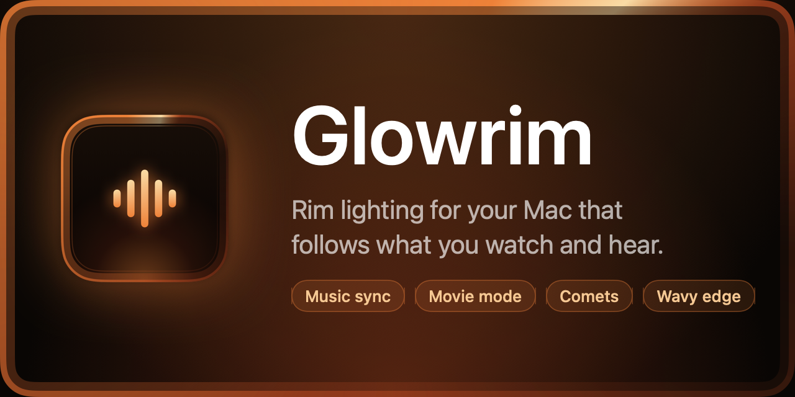
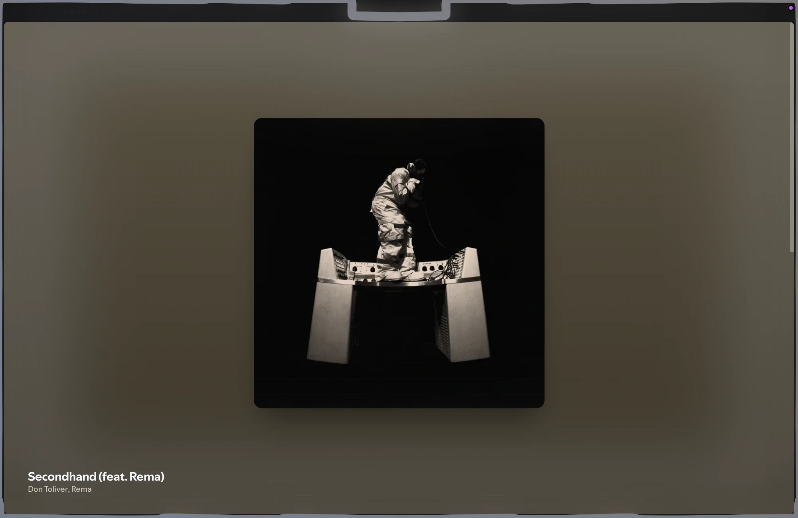
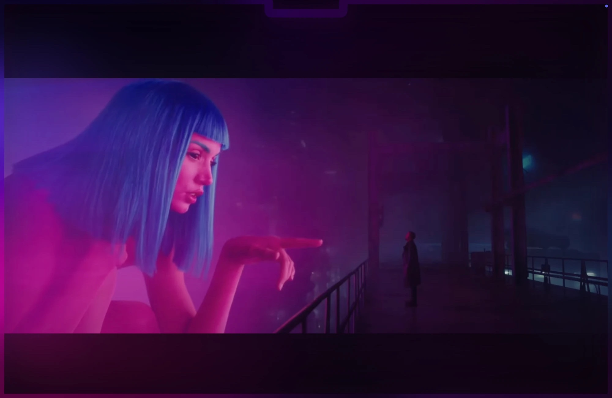
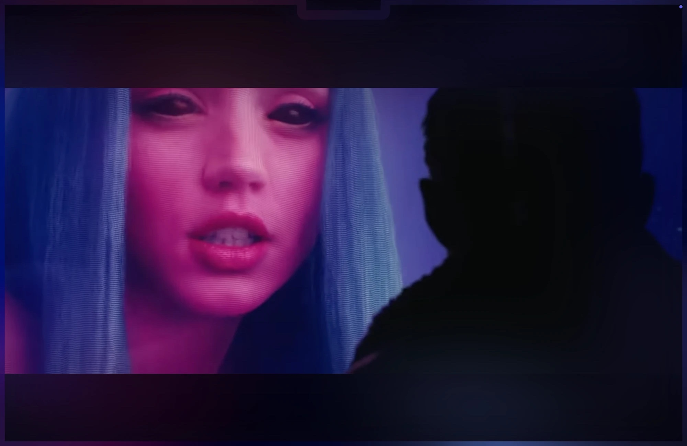
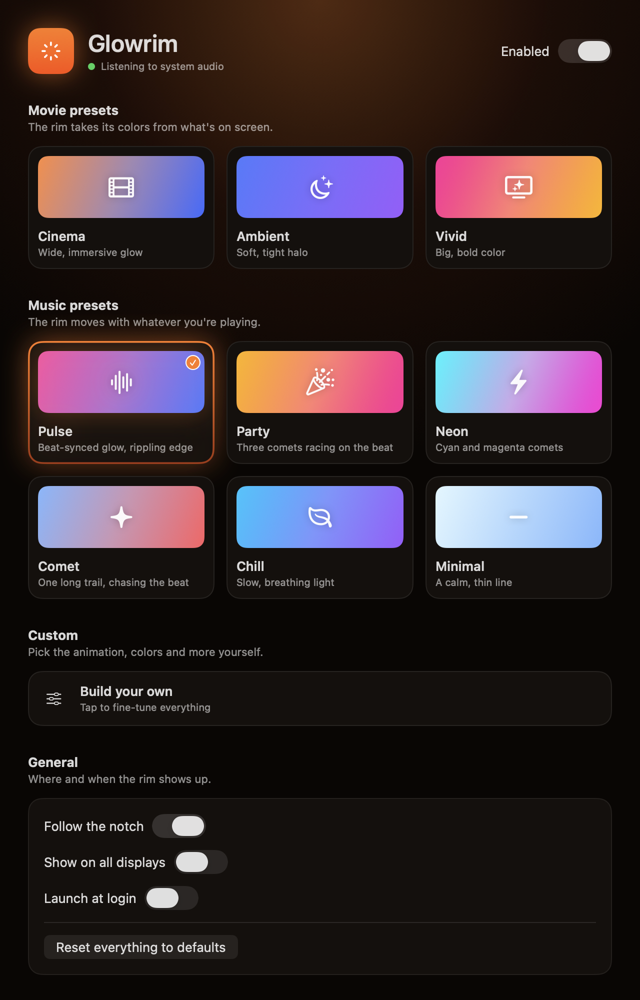
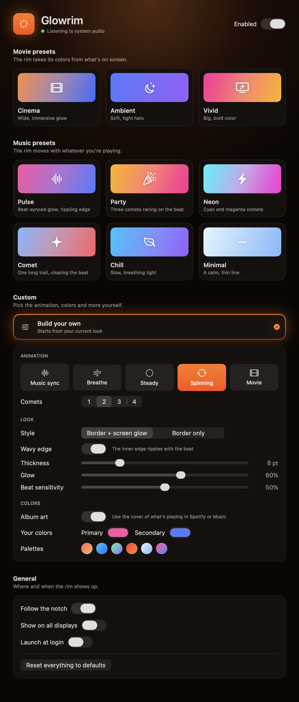

<p align="center">
  
</p>

<p align="center">
  A menu-bar app that rims your Mac's screen with light.<br>
  It beats with your music, takes its colors from your movies, and gets out of the way.
</p>

<p align="center">
  
  
  
</p>

---

## What it does

**Music sync.** The rim pulses with the beat of whatever your Mac is playing, using system audio (never the microphone). Colors come from the current album art in Spotify or Music, or from colors you pick.

<p align="center"></p>

**Movie mode.** The rim takes its colors from what's on screen, like a bias light for your display. Letterbox bars are skipped, so wide films still light up top and bottom.

<p align="center">
  
  
</p>

### Highlights

- **Presets.** One click: *Cinema*, *Ambient*, *Vivid* for movies; *Pulse*, *Party*, *Neon*, *Comet*, *Chill*, *Minimal* for music.
- **Custom.** Choose the animation (Music sync, Breathe, Steady, Spinning, Movie), the number of comets, border-only or screen glow, thickness, glow, beat sensitivity and colors.
- **Comets.** Spinning mode sends 1 to 4 comets with long fading trails around the screen, faster on louder music.
- **Wavy edge.** The inner edge ripples with the music, each beat sending a pulse around the border.
- **Built for the notch.** The rim follows the notch and the rounded corners of the built-in display, or covers all displays.
- **Light on resources.** Adaptive frame rate, a half-size blurred bloom, and everything pauses while the display sleeps.

## Settings

Pick a preset, or choose **Custom** to build your own look. The menu bar menu switches presets quickly; **Settings…** (⌘,) has everything.

<p align="center">
  
  
</p>

## Install

### Download (no developer tools needed)

1. Download **`Glowrim-0.1.0.zip`** from the [latest release](https://github.com/raykrz/Glowrim/releases/latest) and unzip it.
2. Drag **Glowrim.app** to your Applications folder and open it. It lives in the menu bar (look for the rays icon).

It runs natively on Apple Silicon and Intel Macs, on **macOS 14.2 or later**.

**First launch.** Glowrim isn't notarized by Apple (that needs a paid developer account), so macOS blocks the first open of a downloaded copy. Allow it once:

- Try to open it, then go to **System Settings → Privacy & Security**, scroll to the message about Glowrim and click **Open Anyway**.
- Or, in Terminal, clear the download flag and open it normally:

  ```sh
  xattr -dr com.apple.quarantine /Applications/Glowrim.app
  ```

The source is all here, and you can build it yourself if you'd rather not trust a binary.

### Build from source

Needs the Command Line Tools (`xcode-select --install`). Xcode isn't needed.

```sh
git clone https://github.com/raykrz/Glowrim.git
cd Glowrim
chmod +x build.sh
./build.sh
open Glowrim.app
```

`./package.sh` builds a universal app and zips it into `dist/` for a release. Once Glowrim is in `/Applications`, turn on **Launch at login** in Settings.

## Permissions

macOS asks for these the first time they're needed:

| Permission | Why | When |
|---|---|---|
| **System Audio Recording** | Beat sync from the system audio output | Music sync and Spinning |
| **Automation** (Spotify / Music) | Read the current album art | When a track plays |
| **Screen Recording** | A tiny 96-pixel-wide capture to read edge colors; Glowrim's own glow is excluded, and nothing is saved or sent | Movie mode only |

You may need to relaunch Glowrim after allowing Screen Recording. If you missed a prompt, find it in System Settings → Privacy & Security.

`build.sh` signs the app ad-hoc but pins its identity to the bundle identifier, so permissions survive rebuilds. If macOS keeps asking after updating from an older build, clear the stale entries once:

```sh
tccutil reset ScreenCapture dev.glowrim.app
tccutil reset AudioCapture dev.glowrim.app
```

Recent macOS versions also ask you to re-confirm Screen Recording about once a month. That prompt comes from the system.

## How it works

| File | What it does |
|---|---|
| `SystemAudioTap.swift` | Core Audio process tap and a private aggregate device, giving audio buffers |
| `BeatAnalyzer.swift` | Bass low-pass, auto-gain and onset detection, giving a 0…1 light level |
| `NowPlaying.swift` | Spotify / Music track changes and artwork via AppleScript |
| `ColorExtractor.swift` | Two dominant vivid colors from the album cover |
| `ScreenSampler.swift` | Movie mode: tiny ScreenCaptureKit capture, reduced to a ring of edge colors |
| `GlowView.swift` | Click-through overlay window: gradient band, blurred bloom, notch path, corner fade |
| `EdgeContour.swift` | The screen-edge path as a polyline with normals, pushed inward to make the wave |
| `OverlayController.swift` | One window per display, frame pacing, beat punch, idle breathing |
| `AppDelegate.swift` | Menu-bar quick menu, settings window, wiring |
| `SettingsView.swift` | SwiftUI settings window: preset cards, custom panel, general options |

## Performance

- The frame rate adapts to the look: 60 fps only when the motion needs it (Spinning, Music sync with audio), 30 fps for Breathe, a wavy Steady rim and silence, and almost nothing once a plain Steady rim has settled. Low Power Mode caps it at 30.
- The blurred bloom is drawn at 1/4 size (1/2 for the border-only halo) and scaled up by the compositor.
- Rendering and system-audio capture pause while the displays sleep.

## License

[MIT](LICENSE)
